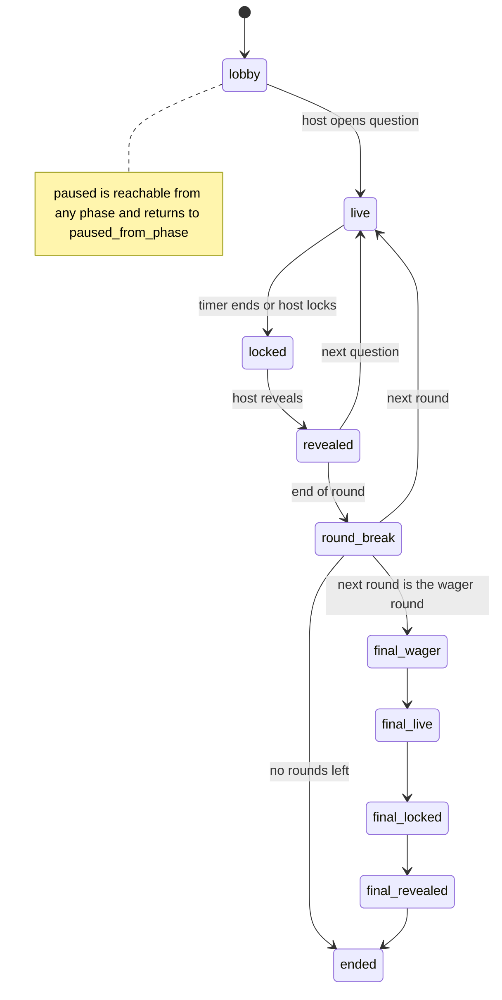

# NightLife Trivia — Build Spec for Claude Code

> **How to use this file:** Save it in the repo as `docs/SPEC.md`. Start Claude Code in the repo and say:
> *"Read docs/SPEC.md. Create CLAUDE.md from section 11, then plan Milestone 0 in plan mode and wait for my approval."*
> Build one milestone at a time. Stop after each milestone, show what was built, and wait for review.

---

## 1. What we are building

A mobile web app for a weekly trivia league at Thursday NightLife at the California Academy of Sciences. Players scan a QR code on the big screen, join a team, and answer live questions on their phones. A host runs the night from a control panel. Staff manage questions and prize redemption.

- **No native app.** A mobile-first web app opened from a QR code. No download, no required account.
- **Demo scope.** This is built to demonstrate the concept, not to run as a long-term service. Prefer the simplest thing that works on one server.
- **Low scale.** Tens of concurrent players, plan for a ceiling of ~150. One game per night, one night per week. One Node process and one SQLite file. Do not build for scale: no queues, caches, microservices or multiple server instances.
- **Server-authoritative.** The browser is untrusted. Correct answers, timing and scoring are enforced on the server, never on the client.

The existing clickable prototype (simulated data) is a **behavior reference only** (flows, states, copy). Do not port its code.

---

## 2. Decisions already made

Use these defaults. Items marked *(configurable)* must be a setting, not hard-coded, because the team may change them after testing.

| Area | Decision |
|---|---|
| Front end | React + Vite + TypeScript SPA, React Router, Tailwind CSS v4 |
| UI primitives | shadcn/ui (Radix) |
| Client state | TanStack Query for fetched data; a small Zustand store for live game state |
| Backend | One Node.js (current LTS) process running Hono (`@hono/node-server`). It serves the JSON API, the WebSocket, media files and the built SPA from one origin |
| Database | SQLite (one file) via `better-sqlite3`; Drizzle ORM for schema and queries, `drizzle-kit` for migrations |
| Real-time | WebSocket on the same server (`upgradeWebSocket` built into `@hono/node-server`, with `ws`) |
| Game logic | TypeScript modules in `server/game/`; route handlers only authenticate, validate input and call into them |
| Validation | `zod` schemas in `shared/`, used by client and server (`@hono/zod-validator` on routes) |
| Auth | Guests get a random session token in an httpOnly cookie; no sign-up. Host and staff unlock their role with a shared passcode per role, set in server env. No email login |
| Server tooling | `tsx` to run the server and scripts in development; `concurrently` to start Vite and the server together |
| Other packages | `qrcode` (QR codes), `barcode-detector` (camera QR scanning on the staff redeem page; covers iOS Safari), `obscenity` (team-name check), `papaparse` (CSV import). Tests: Vitest, Playwright, `@axe-core/playwright` |
| Hosting | A single instance on a host with a persistent disk (Fly.io, Railway, or Render with a disk) |
| Teams | 1 to `max_team_size` players *(configurable, default 6)*; a solo player is a team of one (single code path). One team per player per event |
| Team submissions | Any member can submit; the last submitted answer before lock wins *(configurable: `any_member` \| `captain_only`)*. Drafts never overwrite a submitted answer (section 5) |
| Speed bonus | Off for the first build *(configurable: `off` \| `tiered`)* |
| Typed answers | Normalize, then exact match or trigram similarity (a TypeScript implementation that mirrors `pg_trgm`); borderline answers flagged for host review |
| Question authoring | Google Sheet exported to CSV, loaded with an import script |
| Live-question background | Cream by default *(configurable: `cream` \| `violet`, for an A/B test)* |
| i18n | All user-facing strings through `react-i18next` from day one; English only for now |

Do not add libraries beyond these without asking.

---

## 3. App structure

One app, three route groups:

| Route | Who | Purpose |
|---|---|---|
| `/play/:joinCode` | Players | Join, lobby, live question, reveal, leaderboard, rewards |
| `/host/:eventId` | Host role | Control panel: start, pause, skip, lock, reveal, next; flagged answers; team-name approval; score adjust |
| `/host/:eventId/display` | Projector | Read-only big screen: QR + join code, question, countdown, reveal + fun fact, top 5 |
| `/staff/*` | Staff role | Redeem prize codes, plan nights, approve names, view analytics |

Host and staff routes ask for that role's passcode when the current session doesn't have it. The big-screen display runs in a host session.

Player tabs in Phase 1: **Play**, **Leaderboard**, **Rewards**. Leave layout room for Tonight, Plan, Explore, Profile tabs later.

### Repo layout

```
nightlife-trivia/
  CLAUDE.md
  docs/SPEC.md                 # this file
  design/screens/              # approved designs from Claude Design (PNG + notes.md per screen)
  src/
    routes/play/ routes/host/ routes/staff/
    components/                # shared UI, built only on tokens
    game/                      # live game store, clock sync, reconnect logic
    lib/api.ts                 # typed API client (Hono client; types come from the server)
    lib/socket.ts              # WebSocket connection with reconnect
    i18n/
    styles/tokens.css          # the ONLY place colors, fonts, radii are defined
  server/
    index.ts                   # Hono app: /api, /ws, /media and the built SPA
    db/schema.ts               # Drizzle schema; the only place tables are defined
    db/migrations/             # generated by drizzle-kit; never edited once applied
    db/queries.ts              # leaderboard and stats queries
    db/seed.ts
    game/                      # state machine, timers, scoring, answer matching
    realtime/                  # WebSocket rooms and broadcasts
    auth/                      # sessions, passcode login, role checks
    tests/                     # Vitest: game rules, authorization, matching
  shared/                      # zod schemas and types used by client and server
  data/                        # gitignored: SQLite file and media (DATA_DIR in development)
  scripts/
    simulate-players.ts
    import-questions.ts
  tests/e2e/                   # Playwright
```

---

## 4. Data model

All tables are defined in `server/db/schema.ts`. SQLite conventions: IDs are TEXT UUIDs (`crypto.randomUUID()`); timestamps are INTEGER Unix milliseconds (UTC); booleans are INTEGER 0/1; columns marked `jsonb` or `text[]` below are TEXT holding JSON; enum columns are TEXT with a CHECK constraint.

SQLite has no row-level security. The last column says what the API may send to whom, and route handlers enforce it.

| Table | Columns | Sent to clients |
|---|---|---|
| `seasons` | id, name, starts_on, ends_on | Everyone |
| `themes` | id, name, slug, badge_image_url, accent_token | Everyone |
| `events` | id, season_id, theme_id, starts_at, join_code (unique, 4–5 chars), status (`draft`,`ready`,`live`,`ended`), settings jsonb | Everyone |
| `rounds` | id, event_id, position, title, format (`standard`,`picture`,`sound`,`wager`); at most one `wager` round per event, and it must be last | Everyone |
| `questions` | id, theme_id, type (`mc`,`typed`,`true_false`,`closest_number`), prompt, options jsonb, media_kind (`none`,`image`,`audio`), media_url, caption, fun_fact, difficulty, author | Staff only (players receive a question only through the live payload) |
| `question_answers` | question_id, accepted_answers text[], correct_option, numeric_answer | **Never.** Read only by scoring and the reveal-payload builder. |
| `event_questions` | id, event_id, round_id, question_id, position, duration_s, points | Staff |
| `game_state` | event_id (PK), phase, current_event_question_id, opens_at, closes_at, paused_at, paused_from_phase, live_payload jsonb, reveal_payload jsonb | Everyone in the event (pushed over the WebSocket) |
| `players` | id, nickname, display_mode (`nickname`,`first_name`,`initials`), extra_time_s | Self; others see nickname only |
| `teams` | id, event_id, name, captain_id, name_status (`pending`,`approved`,`rejected`) | Everyone in the event (approved names only on display) |
| `team_members` | team_id, event_id, player_id; unique (event_id, player_id) | Team; member counts public |
| `submissions` | id, event_question_id, team_id, answer jsonb, updated_by, received_at, is_draft, auto_result (`correct`,`incorrect`,`review`), override_result, wager | Own team; staff |
| `score_events` | id, team_id, event_question_id, points, reason (`correct`,`speed`,`wager`,`adjust`), note | Everyone, after reveal |
| `badges`, `player_badges` | badge_id, player_id, earned_at | Self; public on profile |
| `rewards` | id, name, tier, description, expires_after_days, per_person_limit | Everyone |
| `reward_awards` | id, reward_id, player_id, code (random, unguessable), status (`issued`,`redeemed`,`expired`), issued_at, expires_at, redeemed_by, redeemed_at | Self; staff |
| `newsletter_optins` | id, player_id, email, topics text[], consent_at, source | Staff only |
| `feedback` | id, event_id, player_id, rating 1–5, comment | Staff only |
| `sessions` | id (SHA-256 of the cookie token), player_id, role (`player`,`host`,`staff`), created_at, expires_at | Never |

A question's `type` is only how players answer. Any type can carry an image or audio clip through `media_kind`; picture and sound rounds are rounds whose questions use media.

### Leaderboard queries

Functions in `server/db/queries.ts`:

- `eventLeaderboard(eventId)`: total points per team for one night.
- `seasonLeaderboard(seasonId)`: points per player across the season (each team member receives the team's points).
- `playerStats(playerId)`: accuracy, best streak, nights played, favorite category.

Plain queries are fast enough at this scale; don't add caching.

### Seed data (`server/db/seed.ts`)

One season, one theme ("Deep Sea Night"), one event with join code `DEMO1`, 4 rounds, ~30 questions covering every type, three rewards. Host and staff access comes from the passcodes in `.env` (section 10), so no accounts are seeded.

---

## 5. Game engine

### Phases



Only the host moves the game forward; the one exception is the server's auto-lock when time runs out (see Timing). Answers are accepted only in `live` and `final_live`.

The event's `wager` round (section 4) is the final round. It has one question and runs through the `final_*` phases instead of `live`/`locked`/`revealed`. An event without a `wager` round goes from its last `round_break` to `ended`.

### Game API (the entire game interface)

All rules live in `server/game/`. The client reaches them only through these operations, each an HTTP route under `/api` (`GET` for reads, `POST` for the rest, e.g. `POST /api/submit_answer`). Route handlers check the session and role, validate input with zod, and call into `server/game/`. The client calls nothing else to play.

| Operation | Caller | Behavior |
|---|---|---|
| `server_time()` | Anyone | Returns the server's current time in ms. Used for clock sync. |
| `login(passcode)` | Anyone | If the passcode matches `HOST_PASSCODE` or `STAFF_PASSCODE`, gives the current session that role. `staff` can do everything `host` can. At most 5 attempts per minute per IP. |
| `join_event(join_code, nickname)` | Player | Creates the guest session cookie if missing, creates/updates the `players` row, returns event + state. |
| `create_team(event_id, name)` / `join_team(team_id)` | Player | A player is on at most one team per event, and a team can't exceed `max_team_size`. Players can join a team at any time, but once the first question opens, a player who is on a team can't leave or switch. Team name runs a profanity check and is `pending` until host approves. |
| `get_state(event_id)` | Player/host | Returns `game_state` plus the caller's team's current submission. Used on every reconnect. |
| `host_open_question(event_id)` | Host | Sets phase `live`, `opens_at = now`, `closes_at = now + duration_s`, builds `live_payload` **without any answer data**, arms the auto-lock timer. |
| `host_lock(event_id)` | Host | Phase `locked`. The auto-lock timer does the same. |
| `host_reveal(event_id)` | Host | Scores all submissions, writes `score_events`, sets `reveal_payload` (correct answer + fun fact), phase `revealed`. |
| `host_next(event_id)` / `host_pause` / `host_resume` / `host_skip` | Host | Phase transitions per the diagram. |
| `host_override(submission_id, result)` / `host_adjust_score(team_id, points, note)` | Host | Manual corrections, always with a reason. |
| `submit_answer(event_question_id, answer, is_draft)` | Player | Checks caller is on a team, question is live, `now() <= closes_at + grace` (+ player's `extra_time_s`). One row per team per question. A submit (`is_draft = false`) always replaces the row; a draft only replaces another draft and is ignored once the team has submitted. Stores **server** `received_at`. Rate limit: 5 writes per player per second. |
| `submit_wager(event_question_id, amount)` | Player | Only in `final_wager`. Same team checks as `submit_answer`. `amount` is 0..the team's current score; stored on the team's submission row for the final question; the last wager before `final_live` wins. |
| `redeem_code(code)` | Staff | Marks a valid, unexpired, issued code as redeemed. |
| `delete_my_account()` | Player | Removes personal rows and the session; keeps anonymized score totals. |

Every operation checks the session's role where relevant.

### Real-time

- Each client opens one WebSocket to `/ws`. The session cookie authenticates it, and the server adds the connection to its event's room and its team's room.
- The server pushes a `state` message (the event's `game_state`) to the event room on every phase change, and a `team_submission` message to a team's room when that team's submission changes. Host connections also receive connected and answered team counts and the review queue.
- **Never rely on receiving every message.** On connect, reconnect, tab focus and app resume, call `get_state()` and render from it. Reconnect with backoff.
- Typed answers save as drafts (`is_draft = true`) on a ~500 ms debounce so nothing is lost on a dropped connection. At lock, the team's submitted answer is scored; if the team never submitted, its latest draft is.

### Timing

- **Clock sync:** on join, call `server_time()` three times; store the median offset. Countdown = `closes_at − (Date.now() + offset)`.
- **Grace window:** accept submissions up to `settings.grace_ms` (default 1200 ms) after `closes_at`.
- **Auto-lock:** when a question opens, the server sets a timer for `closes_at + grace_ms` plus the largest `extra_time_s` among the event's players. When it fires, the phase moves to `locked` and is broadcast. On startup, the server re-arms the timer for any open question, or locks it immediately if the deadline has passed.
- **Pause:** pausing stores `paused_at` and stops the timer; answers are rejected while paused. On resume, `opens_at` and `closes_at` move forward by the paused duration and the timer is re-armed.
- **Speed bonus (when enabled):** three tiers by server `received_at` (first, middle, last third of the timer). Never per-millisecond.

### Answer checking

- Normalize: lowercase, trim, collapse whitespace, strip punctuation and leading articles (a, an, the), simple plural stripping.
- Exact match against any `accepted_answers` → `correct`.
- Else trigram similarity ≥ `settings.auto_accept_threshold` (default 0.8) → `correct`; ≥ `settings.review_threshold` (default 0.5) → `review`; else `incorrect`. Implement similarity in `server/game/matching.ts` the way `pg_trgm` does it: pad each word with two leading spaces and one trailing space, then score = shared trigrams ÷ total distinct trigrams.
- `closest_number`: store distance from `numeric_answer`; closest team(s) win points; distance also used as the tiebreaker.
- `wager`: team bets 0..current score in `final_wager` via `submit_wager`; gains or loses the wager on reveal. If the team's score has dropped below its wager by reveal (e.g. after an override), the wager is capped at the current score. No wager submitted counts as 0.
- Host sees all `review` items and can override before or after reveal.

---

## 6. Security rules (non-negotiable)

1. Every API route and WebSocket message checks the session and role. A test calls every host and staff route with a player session and expects 403.
2. `question_answers` is never sent to a client. Only the scoring code and the reveal-payload builder read it.
3. `live_payload` never contains answer fields. A test asserts this for every question type.
4. Submissions after `closes_at + grace` are rejected server-side.
5. Players can read only their own team's submissions.
6. Secrets (`HOST_PASSCODE`, `STAFF_PASSCODE`) live only in the server's env. The client bundle contains no secrets, and no `VITE_` env var holds anything sensitive.
7. Redemption codes are random (≥ 10 chars, unambiguous alphabet), single use, expire, and are staff-only to redeem.
8. Team names: `obscenity` package check on the server in `create_team` + host approval before showing on the big screen.
9. Session cookies are httpOnly, `SameSite=Lax`, and `Secure` in production. Tokens are 32 random bytes, stored only as a hash. The WebSocket upgrade checks the `Origin` header.
10. All SQL is parameterized (Drizzle or prepared statements). Every request body and WebSocket message is validated with zod.

---

## 7. Design system and UI

### Tokens (`src/styles/tokens.css`)

Components must never use a raw color value. Use Tailwind v4 and define these tokens in an `@theme` block in `tokens.css` that starts with `--color-*: initial;`, so Tailwind's built-in palette (`bg-green-500` and the rest) doesn't exist. Map shadcn/ui's variables (`--background`, `--foreground`, `--primary`, `--destructive`, `--ring`, `--border` and the rest) to these tokens inside `tokens.css`, and remove the color block that `shadcn init` writes to another file.

| Token | Value | Job |
|---|---|---|
| `--color-bg` | `#FBF6EA` | App background (cream) |
| `--color-surface` | `#FFFFFF` | Cards |
| `--color-brand` | `#7C4DFF` | Primary buttons, brand accent |
| `--color-brand-deep` | `#35236B` | Headers, nav, optional violet live-question background |
| `--color-correct` | `#1FA58A` | Correct answers, success |
| `--color-incorrect` | `#C62D3A` | Incorrect answers, errors, destructive actions |
| `--color-depth` | `#1F5C4D` | Depth, secondary surfaces |
| `--color-info` | `#2F6FE4` | Info, links |
| `--color-info-soft` | `#A9D8F5` | Soft backgrounds |
| `--color-win` | `#F6C945` | Winners, streaks (dark text only) |
| `--color-urgent` | `#F28C38` | Timer, urgent actions (dark text only) |
| `--color-ink` | `#1D1B26` | Body text |
| `--color-ink-muted` | `#5E5A6B` | Secondary text |
| `--color-border` | `#8C8698` | Input borders, dividers |
| `--color-focus` | `#2F6FE4` | Focus ring, drawn with a 2px offset so it shows on dark surfaces |

Fonts and radii also live in `tokens.css`: `--font-sans` (a system font stack until the design picks fonts) and `--radius` (12px).

These are starting values. The final values come from the Claude Design design system; if `design/screens/` or a newer tokens note disagrees with this table, ask which wins.

### UI rules

- Question text ≥ 20px. Tap targets ≥ 44px. One primary button per screen.
- Max two or three bright colors per screen; cream does most of the work.
- Correct/incorrect always pairs color with an icon **and** a word.
- Clear status states on every play screen: waiting for host, question live, answers locked, results in.
- Friendly empty states (e.g. "Scores appear once the round starts.").
- Subtle motion only (countdown ring, small celebration); fully disabled under `prefers-reduced-motion`. No flashing.
- `aria-live` region announces phase changes ("Question 4 is live, 20 seconds").
- Captions shown by default for sound questions.
- Build each screen to match its reference in `design/screens/`. If a screen has no reference yet, build a clean placeholder on tokens and note it.

### Screens needed for Phase 1

Join (landing → nickname → create/join team), Lobby, Live question (MC, typed, true/false, closest number; any of them with an image or audio clip), Locked, Reveal + fun fact, Round break, Final wager, Leaderboard (tonight + season), Rewards + redemption code (QR), Feedback, Host control panel, Big-screen display, Staff redeem page.

---

## 8. Milestones

Build in order. At the end of each milestone: run all tests, run the dev server, summarize what changed, list anything skipped, and stop for review.

### Milestone 0 — Foundation
- [ ] Scaffold Vite + React + TS + Tailwind v4 + React Router + shadcn/ui + react-i18next into the existing repo. Don't delete `docs/`, `design/` or `.gitignore`; if a generator wants an empty folder, scaffold in a temporary folder and copy the files in
- [ ] `tokens.css` (Tailwind `@theme` and the shadcn variable mapping from section 7); lint rule (or test) that fails on raw color values in `src/` outside `tokens.css`: hex, `rgb()`/`hsl()`/`oklch()`, and arbitrary classes like `bg-[#fff]`
- [ ] Hono server with `GET /api/health` and a WebSocket echo at `/ws`; the Vite dev server proxies `/api`, `/ws` and `/media` to it; `npm run dev` starts both
- [ ] SQLite + Drizzle: empty schema file and `db:generate`, `db:migrate`, `db:seed` scripts; every connection opens with `foreign_keys = ON` and WAL mode
- [ ] Vitest (client and server) and Playwright set up with one passing test each
- [ ] `CLAUDE.md` created from section 11
- **Done when:** `npm install`, `npm run db:migrate`, `npm run dev`, `npm test` and `npm run e2e` all work from a clean clone.

### Milestone 1 — Schema, sessions and authorization
- [ ] Drizzle schema and migration for all section 4 tables, with foreign keys and CHECK constraints on enum columns
- [ ] Guest sessions (cookie), `login(passcode)`, and role-check middleware
- [ ] Leaderboard queries: `eventLeaderboard`, `seasonLeaderboard`
- [ ] `seed.ts` per section 4
- [ ] Vitest tests for every rule in section 6 that can be tested at this stage
- **Done when:** a test proves a player session cannot get `question_answers`, other teams' submissions, or any host or staff route.

### Milestone 2 — Game engine (server only)
- [ ] All operations in section 5 except redemption and account deletion
- [ ] WebSocket rooms and broadcasts per section 5
- [ ] Answer normalization and matching, closest-number, wager scoring
- [ ] Auto-lock timer, pause/resume clock shift, timer re-arm on restart
- [ ] Vitest tests (in-memory SQLite, fake timers): late submission rejected; grace window honored; draft upsert; a draft never overwrites a submitted answer; last submit wins; latest draft scored when nothing was submitted; one team per player per event; no team switching after the first question opens; wager capped at current score; scoring correct for every type; tiebreaker; pause/resume returns to prior phase and shifts `closes_at`; auto-lock fires; restart re-arms the timer; payload never contains answers
- **Done when:** a full scripted game runs from `lobby` to `ended` in tests.

### Milestone 3 — Player app
- [ ] Guest session, nickname, create/join team, lobby
- [ ] Live screens for every question type; countdown with clock sync; draft saving; reconnect via `get_state()` on focus/resume/reconnect
- [ ] Reveal, round break, final wager, tonight leaderboard
- [ ] Accessibility: aria-live announcements, reduced motion, axe checks in Playwright
- **Done when:** a Playwright test with two browser contexts (host via API calls after passcode login, player via UI) plays three questions end to end.

### Milestone 4 — Host console and big screen
- [ ] `/host/:eventId`: phase controls with one obvious next action, connected/answered team counts, review queue with overrides, team-name approval, score adjust
- [ ] `/host/:eventId/display`: QR (`qrcode` package) + join code in lobby, question + countdown, reveal + fun fact, top 5 between rounds
- [ ] Host and staff passcode screens; role checks on every host and staff route
- **Done when:** a full night can be hosted from a tablet while the display runs in another browser.

### Milestone 5 — Load test and import
- [ ] `scripts/simulate-players.ts`: N fake teams (default 40, max 150) each get their own guest session, open a WebSocket, answer with random delays and some typos, randomly disconnect and reconnect; reports lost or rejected submissions and submit latency
- [ ] `scripts/import-questions.ts`: CSV → `questions` + `question_answers`; validates every row and reports errors by line; downloads media into `DATA_DIR/media` under random file names (a name like `giant-squid.jpg` would give away the answer)
- **Done when:** a 40-team simulated game has zero lost submissions and the host console stays responsive.

### Milestone 6 — Rewards, feedback, polish
- [ ] Award top teams at `ended`; `reward_awards` with code + QR in the Rewards tab
- [ ] `/staff/redeem`: scan or type code; list issued/redeemed
- [ ] Post-game 1–5 feedback
- [ ] Privacy policy page, `delete_my_account()`, newsletter opt-in (unchecked box, stored consent, CSV export for staff)
- [ ] Settings toggles for the configurable items in section 2
- **Done when:** the pilot launch checklist in section 9 can be completed.

### Later (do not build yet)
Phase 2: Tonight and Plan tabs, `.ics` add-to-calendar, profiles, badges, email login that keeps guest history (magic link), shareable result cards (`html-to-image` + Web Share API), theme calendar with suggestions, installable PWA.
Phase 3: museum map (static SVG with hotspots), My Animal feed, membership links, friends. Direct messaging only after reporting/blocking tools exist.

---

## 9. Testing and launch

| Layer | Tool | Must prove |
|---|---|---|
| Game rules + authorization | Vitest (server, in-memory SQLite) | Section 5 and 6 rules |
| Answer matching | Vitest table tests | e.g. "The Mitochondria", "mitochondrion", "mitocondria" resolve as intended |
| Flows | Playwright | Join → answer → lock → reveal → leaderboard |
| Accessibility | `@axe-core/playwright` | No WCAG 2.2 AA violations on core screens |
| Load | `simulate-players.ts` | 40–150 teams, no lost answers |

### Pilot launch checklist (put in `docs/RUNBOOK.md`)
- Event, rounds and questions loaded and previewed on the display the day before
- Server up and reachable from a phone on the venue Wi-Fi; database backed up (`npm run db:backup`)
- Host laptop, projector, backup hotspot, paper answer sheets ready
- Staff redeem page logged in on a staff phone
- After the night: review flagged answers, export results and feedback

---

## 10. Environment and deployment

- `.env` (gitignored, server only) holds `PORT`, `DATA_DIR`, `HOST_PASSCODE` and `STAFF_PASSCODE`. Commit a `.env.example` with placeholder values. The client needs no env vars: it calls the API on its own origin.
- `DATA_DIR` holds the SQLite file and media. Development uses `./data`; never point Claude Code at the deployed data directory.
- One Node process serves `/api`, `/ws`, `/media` and the built SPA, falling back to `index.html` for client routes.
- Deploy a **single instance** to a host with a persistent disk (Fly.io, Railway, or Render with a disk) mounted at `DATA_DIR`. Never run two instances: timers, WebSocket rooms and the SQLite file all live in one process.
- `npm run db:backup` copies the database with `VACUUM INTO`, which is safe while the server runs. Run it before each event.
- Don't deploy on event days. A restart drops every WebSocket; clients recover through `get_state()`, but it is disruptive mid-question.
- Hosting accounts should be created under an Academy-controlled email so ownership is clear after the class project.

---

## 11. Contents for CLAUDE.md

Create `CLAUDE.md` with:

**Stack:** React + Vite + TypeScript, Tailwind, shadcn/ui, TanStack Query, Zustand, react-i18next. Server: Node + Hono + WebSocket, SQLite via better-sqlite3 + Drizzle, zod.

**Commands:** `npm run dev` (Vite + server), `npm test`, `npm run e2e`, `npm run db:generate`, `npm run db:migrate`, `npm run db:seed`, `npm run db:backup`, `npm run simulate -- --teams 40`, `npm run import-questions -- <file.csv>`.

**Hard rules:**
- Never send `question_answers` or answer fields to the client.
- Every API route and WebSocket message checks the session and role and validates input with zod.
- Schema changes only in `server/db/schema.ts` plus a generated migration; never edit a migration that has been applied.
- Game rules live in `server/game/`, not in React or route handlers.
- Parameterized SQL only. SQLite runs with `foreign_keys = ON` and WAL mode.
- One server instance; don't add anything that assumes more than one.
- No raw color values (hex, `rgb()`/`hsl()`/`oklch()`, Tailwind's built-in palette) outside `src/styles/tokens.css`.
- Every user-visible string goes through i18n.
- Accessible by default: labels, focus states, 44px targets, aria-live for phase changes.

**Definition of done for any task:** tests pass, axe passes, the screen matches its `design/screens/` reference at 390px wide, and no rule above is broken.

**Working style:** use plan mode for schema or game-engine changes; keep changes scoped to one task; ask before adding dependencies or changing a decision in section 2.

---

## 12. Open questions (do not block on these)

Build with the defaults above; these will be decided by the team or the Academy later.

- Final prize list and order of value
- Who writes weekly questions and who hosts
- Academy brand guidelines (may change tokens and fonts)
- 21+ and alcohol rules (no mechanic or reward may be tied to buying drinks)
- Academy's email and membership systems
- Wi-Fi conditions in NightLife spaces
- Long-term ownership of the app and data
